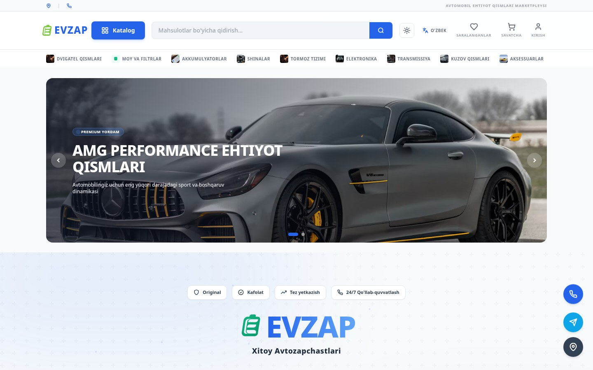
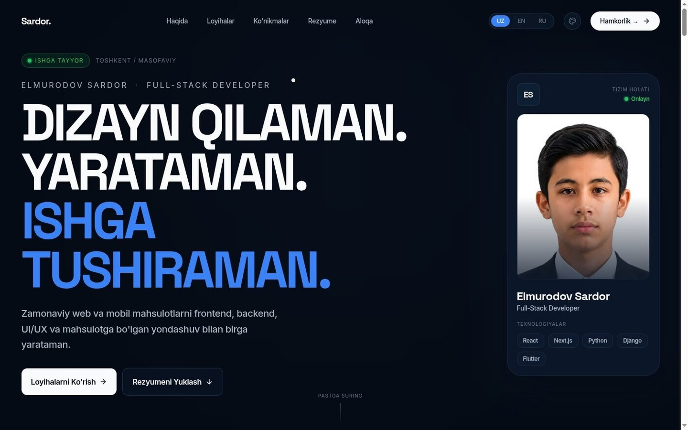
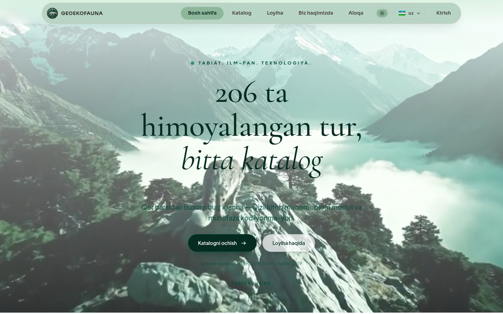

  

**Elmurodov Sardor, full-stack web developer (React / Next.js, Django)**

---

## About

<table>
<tr>
<td width="55%">

**What I do**

I build web products end to end: the React and Next.js interface, the Django REST API, the PostgreSQL queries and the deployment that keeps it running.

Most of the work lands in admin panels and SaaS dashboards, e-commerce, and data-heavy catalog sites.

</td>
<td width="45%">

**Availability**

Open to freelance work, internships and full-time offers.

This site speaks three languages: uz, en, ru.

</td>
</tr>
</table>

---

## Technologies

<table>
<tr>
<td width="50%">

**Frontend**

`React` `Next.js` `TypeScript` `JavaScript` `Tailwind CSS` `Framer Motion`

</td>
<td width="50%">

**Backend**

`Python` `Django` `Django REST Framework` `Flask` `FastAPI` `SQLAlchemy`

</td>
</tr>
<tr>
<td width="50%">

**Mobile & Data**

`Flutter` `Dart` `PostgreSQL` `SQLite` `Redis` `Cloudflare Workers` `D1`

</td>
<td width="50%">

**Tools & Design**

`Figma` `Git` `GitHub` `Docker` `Telegram Bots` `AI Integration`

</td>
</tr>
</table>

Hosted on Vercel, Render and Cloudflare. The Sehrli Qalpoqcha experiment adds `OpenCV` for real-time video processing.

---

## Services

<table>
<tr>
<td width="50%">

**Web sites**

- React/Next.js web applications
- SaaS platforms and admin panels
- E-commerce and CRM systems
- REST APIs and integrations

</td>
<td width="50%">

**Mobile apps**

- iOS/Android apps with Flutter
- Cross-platform from a single codebase
- Play Market and App Store publishing
- Mobile backends and push notifications

</td>
</tr>
</table>

Also: AI and automation, UI/UX design in Figma.

---

## Projects

  
  
  

| Project | What it is | Stack | Live |
|---------|------------|-------|------|
| **EVZAP** | Auto parts store in four languages: session cart, admin panel with two-factor sign-in, Telegram bot | `Flask` `SQLAlchemy` `Tailwind CSS` | [evzap-parts.uz](https://evzap-parts.uz) |
| **This portfolio** | Frontend, API and admin CMS for this site: projects and case studies edited from the browser | `Next.js 16` `React 19` `Django REST` `PostgreSQL` | [sardordev-delta.vercel.app](https://sardordev-delta.vercel.app) |
| **Geoekofauna** | Catalog of Uzbekistan wildlife: 206 protected animals, IUCN and CITES status, PDF reports, Telegram sign-in | `React 19` `Cloudflare Workers` `D1` | [geoecofauna.uz](https://geoecofauna.uz) |
| **BolaJon OS** | Kids learning app: one Flutter codebase for Android, iOS, web and Windows, parent dashboard | `Flutter` `Django REST` `PostgreSQL` | [bolajon-os.vercel.app](https://bolajon-os.vercel.app/) |
| **FixIt** | Platform for finding technicians in Toshkent: describe the problem, compare offers, pick someone | `Next.js 16` `Django REST` `Flutter` | [fixit-chi-weld.vercel.app](https://fixit-chi-weld.vercel.app) |
| **Sehrli Qalpoqcha** | Real-time invisibility cloak experiment with OpenCV | `Python` `OpenCV` | private |
| **Aziz Academy** | Python coursework: over 1,000 exercise files across the modules I completed | `Python` | [public source](https://github.com/Sardor-Dev-2010/aziz-academy-topshiriqlar) |

Client code stays private. Every demo above is open to anyone who wants to click it.

---

## Public code

The public repository worth reading is [aziz-academy-topshiriqlar](https://github.com/Sardor-Dev-2010/aziz-academy-topshiriqlar): over 1,000 Python exercise files from my coursework, with a changelog, contribution guide and security policy. There is also [sardorbuilder-content](https://github.com/Sardor-Dev-2010/sardorbuilder-content), the image assets behind the @sardorbuilder Instagram account.

If you want to see code from the private projects, ask and I will walk you through the architecture on a call.

---

## Get in touch

 

  

